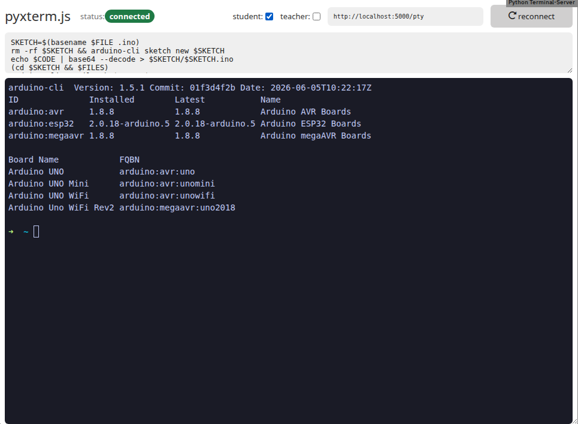
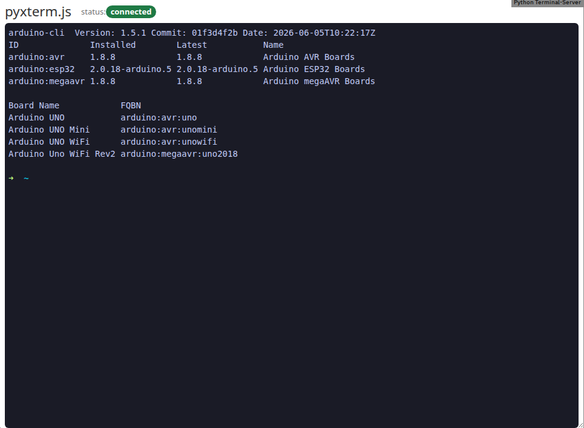

# Edrys PyxTerm.js Module

This module runs a full terminal within [edrys-Lite](https://github.com/edrys-labs/edrys-Lite), an open remote teaching platform.
It is based on [pyxterm.js](https://github.com/cs01/pyxtermjs) by Chad Smith.

<picture>
  <source media="(prefers-color-scheme: dark)" srcset="./screenshots/station-dark.png">
  
</picture>

## Usage

Add the module to your class with this URL:

```bash
https://edrys-labs.github.io/module-pyxtermjs/index.html
```

Open it on a **station** (`show-in: station`): the station's browser connects to a
terminal server on the station's computer and shares the terminal with everyone in the station's room. Any current
browser works; the page itself needs no Web Serial or other device access, the server does that.

Then start the terminal server on the station's computer, either with Docker (see [Docker](#docker)) or from a
clone of this project:

```bash
pip install -r requirements.txt
python3 -m pyxtermjs
```

To restrict what the shell can do, run it in a container (see [Docker](#docker)) or, as below, through
[firejail](https://firejail.wordpress.com/documentation-2/basic-usage/). The `--private-home` option is optional;
it copies your zsh configuration (paths relative to your home) into the firejail home folder.

``` bash
python3 -m pyxtermjs --tmp --command firejail --cmd-args='--noroot --private --quiet --cpu=1 --nice=19 --hostname=host --net=none --no3d --nosound --rlimit-cpu=1 --allow-debuggers --shell=/bin/zsh --private-home=.zshrc,.oh-my-zsh'
```

## Configuration

All settings are station settings (`stationConfig`):

| Setting | Default | Meaning |
|---|---|---|
| `server` | `http://localhost:5000/pty` | the terminal server the station connects to |
| `execute` | `execute` | the message subject on which the station takes code from other modules |
| `workflow` | none | a built-in toolchain that fills in `script`, `board`, `port`, `baud` and `filename`: `arduino-avr`, `arduino-esp32`, `arduino-nano-esp32`, `arduino-stm32`, `avr-gcc`, `micropython`, `native` |
| `board` | from the workflow | `$BOARD`, e.g. an FQBN such as `arduino:avr:uno` |
| `port` | from the workflow | `$PORT`, e.g. `/dev/ttyACM0` |
| `baud` | from the workflow | `$BAUD`, e.g. `9600` |
| `filename` | from the workflow | `$FILE`, and the main file of a multi-file project |
| `script` | `echo $CODE \| base64 --decode` | typed into the shell for every piece of code; overrides the workflow's script |
| `enable` | none ticked | `student` / `teacher`: who may type and run code (see below) |

``` json
{ "server": "http://localhost:5000/pty"
, "execute": "execute"
, "workflow": "arduino-avr"
, "port": "/dev/ttyACM0"
, "enable": { "teacher": true, "student": false }
}
```

Placeholders in the script, filled in for every run:

- `$CODE`: the code, base64-encoded (decode it with `echo $CODE | base64 --decode`)
- `$FILE`, `$BOARD`, `$PORT`, `$BAUD`: the settings above
- `$FILES`: commands that write the other files of a multi-file project into the current directory (`true` when
  there are none). If the script has no `$FILES`, those files are written before the script runs.

Before each run the station sends two ctrl+c, to stop whatever was still running.

A module can also send a multi-file project, as module-editor's multi-file mode does:
`{"file": {"Sketch.ino": "...", "util.h": "..."}}` (as JSON text or as an object). The main file becomes `$CODE`:
the one named like the `filename` setting, else the first with the same extension, else the first. File names
must be plain names (letters, digits, `_`, `.`, `-`; no paths, no leading dot). Other files are skipped with a
warning in the console.

By default students and teachers cannot use the terminal, they will see only the output: they can neither type
into it nor run code from an editor module, because that code runs on the station's computer too.
You will have to grant access via the `enable` checkboxes (`student`, `teacher`), which are only visible on the station.
Code from modules on the station itself always runs.

A student in the station's room sees the same terminal, at the station's size, without the controls:

<picture>
  <source media="(prefers-color-scheme: dark)" srcset="./screenshots/student-dark.png">
  
</picture>

## Messages

All subjects but `join` end in the `execute` setting (`<x>`, by default `execute`), so several terminals can
share a room.

| Subject | From → to | Body |
|---|---|---|
| `<x>` | any module → station | code as a string, or a project `{"file": {name: content}}` |
| `input_<role>_<x>` | student / teacher → station | keystrokes; typed only if `enable` allows the sender's role in the class |
| `join` | peer → station | asks for the status and the screen |
| `connect_<x>` | station → room or one peer | `{ connected, enable, size: { cols, rows } }` |
| `pty-screen_<x>` | station → a joining peer | the whole screen, as terminal output |
| `pty-output_<x>` | station → room | terminal output as it arrives |

The terminal size is the station's: students show the station's columns and rows, and scroll if their frame is
smaller.

## API

```
> python3 -m pyxtermjs --help

usage: __main__.py [-h] [-p PORT] [--cors [CORS]] [--origins ORIGINS] [--host HOST] [--debug] [--version]
                   [--command COMMAND] [--cmd-args CMD_ARGS] [--tmp [TMP]] [--singleton [SINGLETON]]

A fully functional terminal in your browser. https://github.com/cs01/pyxterm.js

options:
  -h, --help            show this help message and exit
  -p PORT, --port PORT  port to run server on (default: 5000)
  --cors [CORS]         enable CORS (env PYXTERM_CORS=True); `--cors True` also works (default: False)
  --origins ORIGINS     comma-separated origins whose pages may connect to the terminal, besides this server itself
                        (env PYXTERM_ORIGINS); '*' allows every website (default: https://edrys-
                        labs.github.io,http://localhost:3002,http://127.0.0.1:3002)
  --host HOST           host to run server on (use 0.0.0.0 to allow access from other hosts) (default: 127.0.0.1)
  --debug               debug the server (default: False)
  --version             print version and exit (default: False)
  --command COMMAND     Command to run in the terminal (default: bash)
  --cmd-args CMD_ARGS   arguments to pass to command (i.e. --cmd-args='arg1 arg2 --flag') (default: )
  --tmp [TMP]           start each shell in a new temporary folder instead of the home directory, which comes handy
                        when using firejail (env PYXTERM_USE_TMP=True) (default: False)
  --singleton [SINGLETON]
                        use a single terminal for all clients (env PYXTERM_SINGLETON=True) (default: False)
```

## Docker

To enable an even more secure usage, you can also start and or modify the included Dockerfile.

Build and run it via:

``` bash
$ docker-compose up
```

or directly load our prebuild image from dockerhub:

``` bash
$ docker run -it -p 127.0.0.1:5000:5000 --device=/dev/ttyACM0:/dev/ttyACM0 edryslabs/module-pyxtermjs:latest
```

Replace `/dev/ttyACM0` with your board's port if it differs - check with
`arduino-cli board list` or `ls /dev/ttyACM* /dev/ttyUSB*`. The board has to be
plugged in before you start the container, otherwise Docker refuses to start
because the device does not exist.

### Boards that upload over DFU

Some boards - such as the **Arduino Nano ESP32** - are not flashed over the
serial port but via DFU. For those, passing `--device` alone is not enough:
`dfu-util` opens the raw USB node through libusb, and every upload fails with

```
dfu-util: unable to initialize libusb: LIBUSB_ERROR_OTHER
```

Start the container with access to the USB devices as well:

``` bash
$ docker run -it -p 127.0.0.1:5000:5000 \
  --device=/dev/ttyACM0:/dev/ttyACM0 \
  -v /dev/bus/usb:/dev/bus/usb \
  --device-cgroup-rule='c 166:* rmw' \
  --device-cgroup-rule='c 189:* rmw' \
  edryslabs/module-pyxtermjs:latest
```

Mount the whole `/dev/bus/usb` tree rather than a single node - a DFU upload
makes the board re-enumerate, so its `/dev/bus/usb/<bus>/<dev>` path changes with
every upload. Note that this grants the container access to all USB devices on
the host.

### ESP32 devkits

Espressif ESP32 boards (the `arduino-esp32` workflow) need the `:esp32` tag -
Espressif's `esp32:esp32` core is too large to ship in `:latest`, and it is a
different core from the `arduino:esp32` one the Arduino Nano ESP32 uses.

These devkits also talk through a CH340/CP210x bridge, so they appear as
`/dev/ttyUSB0` rather than `/dev/ttyACM0`, and `ttyUSB*` has its own device
major number (188 instead of 166):

``` bash
$ docker run -it -p 127.0.0.1:5000:5000 \
  --device=/dev/ttyUSB0:/dev/ttyUSB0 \
  -v /dev/bus/usb:/dev/bus/usb \
  --device-cgroup-rule='c 188:* rmw' \
  --device-cgroup-rule='c 189:* rmw' \
  edryslabs/module-pyxtermjs:esp32
```

### Building your own image

If you need additional tools, compilers, or libraries, you can build your own
image on top of the published ones. Have a look at the included Docker- and
docker-compose files in [docker](./docker) as a starting point - for example
[docker/arduino](./docker/arduino) adds the arduino-cli toolchain, cores, and
libraries on top of the base image.

### For Windows Users

Windows does not natively support USB device passthrough to Docker containers. However, with WSL2 and the `usbipd-win` tool, we can achieve this functionality.

For this you can use the provided Windows starter script located in `docker/windows-starter/start-pyxtermjs.bat`.

**Requirements:**
- Windows 10/11 with WSL2 installed
- Docker Desktop for Windows with WSL2 backend enabled
- [usbipd-win](https://github.com/dorssel/usbipd-win) tool installed

**Usage:**

1. First, run the script without arguments to see available USB devices:
   ```cmd
   start-pyxtermjs.bat
   ```

2. Identify your device's BUSID from the list and run:
   ```cmd
   start-pyxtermjs.bat <BUSID>
   ```
   
   For example:
   ```cmd
   start-pyxtermjs.bat 5-1
   ```

The script will automatically:
- Bind the USB device (if not already bound)
- Detach any existing connection
- Attach the device to WSL
- Start the Docker container with USB device access
- Make the terminal available at `http://localhost:5000`

**Note:** The first time you bind a device, you may need to run the command prompt as Administrator.

#### Manual USB Device Attachment

If you prefer to run the commands manually instead of using the batch file:

1. **List available USB devices:**
   ```cmd
   usbipd list
   ```

2. **Bind the device (one-time setup):**
   ```cmd
   usbipd bind --busid <BUSID>
   ```

3. **Attach the device to WSL:**
   ```cmd
   usbipd attach --wsl --busid <BUSID>
   ```

4. **Start the Docker container:**
   ```cmd
   wsl -e bash -c "docker run -it -p 127.0.0.1:5000:5000 --device=/dev/ttyACM0:/dev/ttyACM0 edryslabs/module-pyxtermjs:latest"
   ```

5. **When finished, detach the device:**
   ```cmd
   usbipd detach --busid <BUSID>
   ```

Replace `<BUSID>` with your actual device's bus ID (e.g., `5-1`).

## Development

The module's source is in [src](./src) and is bundled with [Parcel](https://parceljs.org):

``` bash
npm install
npm run watch   # dev server on http://localhost:3002/index.html, add this URL to a class
npm run build   # production build in dist/
```

`dist/` is not committed. On every push to `master`, the [deploy workflow](./.github/workflows/deploy.yml)
builds it and publishes it to GitHub Pages
(GitHub Pages source: "GitHub Actions").

The terminal server only accepts connections from pages it knows: the published module
(`https://edrys-labs.github.io`), `npm run watch` (`http://localhost:3002`, `http://127.0.0.1:3002`) and its own
pages. Any other website open in the station's browser could otherwise type into the shell. If you serve the
module from somewhere else, list that origin (this replaces the defaults; `localhost` and `127.0.0.1` differ):

``` bash
PYXTERM_ORIGINS=https://my-host.example,https://edrys-labs.github.io python3 -m pyxtermjs
docker run -it -p 127.0.0.1:5000:5000 -e PYXTERM_ORIGINS=https://my-host.example edryslabs/module-pyxtermjs
```

The terminal server serves a standalone terminal without Edrys at `http://localhost:5000/`
([docs/direct.html](./docs/direct.html)).

## Edrys - Classroom

You can try out the following classroom/lab configuration for sharing a terminal with your students:

`https://raw.githubusercontent.com/edrys-labs/module-pyxtermjs/master/laboratory.yaml`

see the configuration [here](./laboratory.yaml).

## License

[MIT](LICENSE) © edrys-labs, based on [pyxterm.js](https://github.com/cs01/pyxtermjs) © Chad Smith
